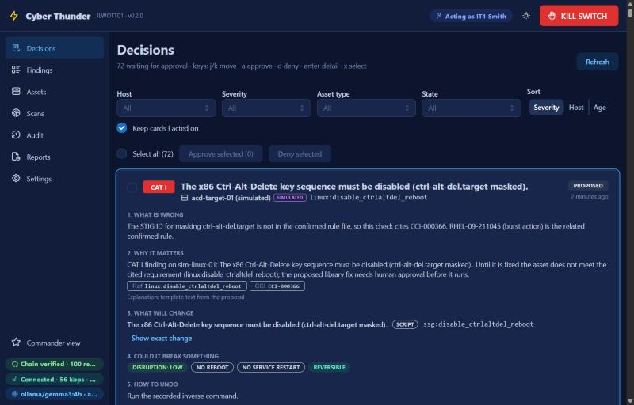
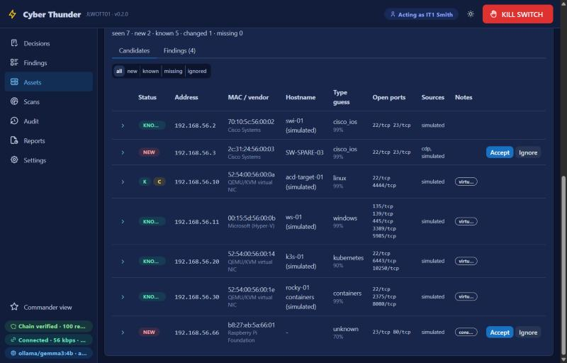
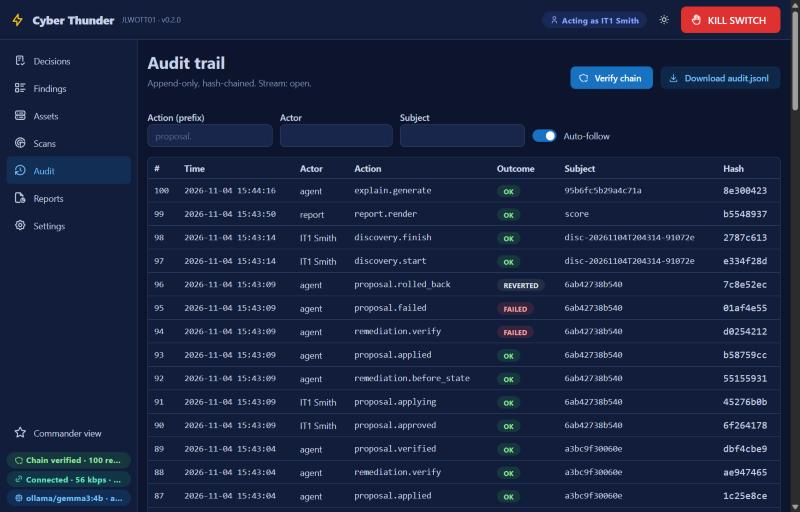
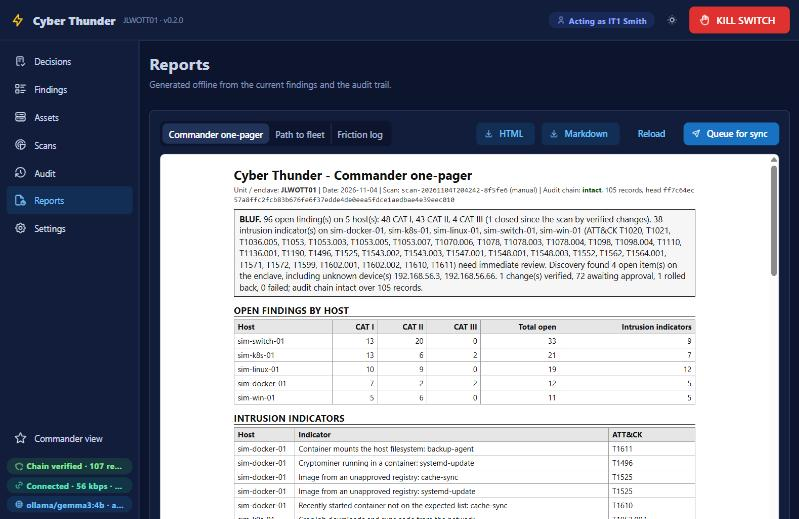

# Cyber Thunder

Cyber Thunder finds, explains and fixes misconfigurations and vulnerabilities on isolated, low-bandwidth
networks, with a human approving every change. It takes the output of the scanners the Navy already fields,
adds its own deterministic checks and an intrusion hunt, and turns the result into a queue of cited,
plain-English decisions. An IT Sailor approves or denies each fix; approved fixes are applied from a vetted
library, verified by rescan, and rolled back automatically if verification fails. Scanning and remediation
can run offline; verified access remains bounded by token, session and cached-key expiry. Every action
lands in a hash-chained audit log.

**We don't reinvent the Navy's scanners. We turn their output into approved, verified, reversible fixes, offline.**

Built for the Department of the Navy hackathon in Norfolk (FLEETHACKER, 4-6 Nov 2026), use case
*Autonomous Cyber Defender*. Deterministic tools detect; a local model only explains; a human decides.

## What it looks like

The decision queue: each card answers what is wrong, why it matters (with citations), what will change, what could
break, and how to undo it. The kill switch and the audit-chain badge are on every screen.



Discovery proposes what it found on the enclave; a named person accepts a device into scope, with a reason, or ignores it.
Verified modes intersect signed identity and role permissions with exact account/group, target,
environment and action grants. Each connection selects its permitted target account; inventory credentials
are not a fallback. Node administration is separate from target administration, and `admin` does not inherit
scan or approval rights. [Account examples](docs/ACCOUNT_ACCESS.md#practical-policy-example) show one user
scanning A, another approving/applying B, and an administrator with no target grant.
Local development uses typed, unverified names. UDS gateway SSO still requires explicit application
identity configuration; see [authorization](docs/AUTHORIZATION.md).



Every action, including refusals and blocks, lands in the hash-chained audit trail, streamed live.



Reports keep searchable history of commander one-pagers, POA&Ms, checklists and target reports, alongside the detection score against the range answer keys.
Saved evidence and exports retain their original target/environment/generation ownership. Current
inventory visibility does not grant access to another owner's historical report, and unknown legacy
ownership is unavailable in verified mode. See [saved provenance](docs/IDENTITY_PROVENANCE.md).



## Status

The rehearsal in [DEMO](docs/DEMO.md) runs the pipeline end to end on the simulated range.

<!-- validation-status:start -->
Rocky 9 over SSH: 12/12 Linux seeds detected; one fix applied, verified and rolled back.

The same range run detected 6/6 Podman seeds and 10/10 k3s seeds (28/28 across all three targets).

The WSL2 UDS demo cluster was scanned over kubectl: 127 findings and no adapter errors.

An isolated export of the public nginx-bad image produced 393 notapplicable OpenSCAP results and three RPM database diagnostics. JSON/SQLite import, reports and restart persistence preserved those observations plus a coverage warning. Effective image STIG checks and platform applicability remain unresolved; no live workload was changed.

These are recorded real-target results, not full benchmark coverage. Windows/WinRM, Cisco device changes and other platform versions still need real testing. See the [validation matrix](docs/VALIDATION.md) for evidence and missing run metadata, and [coverage](docs/COVERAGE.md) for check/fix counts.
<!-- validation-status:end -->

Signed-token and HTTPS test-provider checks cover browser/API approval, logout and idle expiry, with
separate access-policy and credential-boundary tests. These are fixture results, not live UDS realm,
organizational Keycloak, AD/CAC/PKI or deployment acceptance. Native Windows owner/DACL checks now guard
policy, selected Kubernetes credentials and the OIDC cache; service-account, domain, SMB and ReFS
deployment acceptance remains open. See [Windows file trust](docs/WINDOWS_FILE_TRUST.md),
[identity limits](docs/AUTHORIZATION.md) and
[package preflight and acceptance](docs/PACKAGE_IDENTITY.md).

| Module | Path | Status |
|---|---|---|
| Findings schema, XCCDF and CKLB parsers | `cyberthunder/findings/`, `parsers/` | built |
| Hash-chained audit log | `cyberthunder/audit/` | built |
| Kill switch, approval gate, standing-approval policy | `cyberthunder/control/` | built |
| Inventory and scope guardrail | `cyberthunder/inventory/` | built |
| Transports (local, ssh, fixture, winrm) | `cyberthunder/transport/` | built |
| Adapter contract and fix library | `cyberthunder/adapters/base.py`, `remediation/` | built |
| Remediation engine (apply, verify, auto-rollback) | `cyberthunder/remediation/engine.py` | built |
| Scan orchestration | `cyberthunder/scan.py` | built |
| Linux, Cisco, Kubernetes, container, Windows adapters | `cyberthunder/adapters/<type>/` | built |
| DISA SCAP benchmarks run by the tool itself (OVAL evaluator for Windows, DISA datastreams through oscap on Linux) | `cyberthunder/scap/` | built |
| Local-model explanations with citation validation | `cyberthunder/explain/` | built |
| STIG delta ingest, observed link state, explicit test mode and local outbox staging | `cyberthunder/ingest/` | built |
| STIG Library (saved product/type subscriptions, catalog versions, validated uploads, resumable downloads and offline manifests) | `cyberthunder/ingest/content/` | built |
| Reports (one-pager, POA&M, checklist, searchable history) | `cyberthunder/report/` | built |
| HTTP API | `cyberthunder/api/` | built |
| Web UI | `cyberthunder/ui/` | built |
| Asset discovery (scoped sweeps, device typing, propose-only inventory, rogue devices) | `cyberthunder/discovery/` | built |
| Local range and answer keys | `range/` | built (six answer keys) |

## Quick start

Python 3.11 or later. Clone outside any synced folder (for example `C:\dev\cyber-thunder`).

Install runtime and test dependencies (online):

```bash
python -m pip install -r requirements-dev.txt
```

For **64-bit Windows with CPython 3.12**, install offline from the runtime and
test wheels in `vendor/`. `vendor/SHA256SUMS` records their exact bytes:

```bash
python -m pip install --no-index --find-links vendor -r requirements-dev.txt
```

The bundled native wheels do not cover Linux, other architectures or other
Python versions. On a connected machine matching the intended native platform,
prepare its wheel folder, then transfer that folder with the source checkout:

```bash
python -m pip download --only-binary=:all: -r requirements-dev.txt -d wheelhouse
```

On the disconnected machine, use `--find-links wheelhouse` in the offline install
command. Prepare runtime-only installations with `requirements.txt` instead.
Container deployments carry their Linux dependencies in the built image; native
wheels do not replace that image. Scanner databases, benchmarks and model files
must also be provisioned for the intended offline workflow.

Run the tests:

```bash
python -m pytest -q
```

The following native rehearsal uses `CT_AUTH_MODE=dev` on loopback with an explicitly unverified typed
identity. Development mode bypasses verified role/account isolation; forwarding its port does not add
authentication. Use a scratch state directory so it never touches real state:

```bash
export CT_STATE_DIR="$(mktemp -d)"
export CT_AUTH_MODE=dev
export CT_SECURITY_MODE=range
export CT_HOST=127.0.0.1
```

Load the simulated range (one simulated asset per adapter: Linux host, switch config, k3s cluster,
container host, Windows host) and check the node:

```bash
python -m cyberthunder demo load
```

```bash
python -m cyberthunder status
```

Scan, then look at what was found:

```bash
python -m cyberthunder scan
```

```bash
python -m cyberthunder scans list
```

```bash
python -m cyberthunder scans show <scan-id>
```

The scan creates a proposal for every finding that has a library fix. List them, and read one (it prints its
`finding_id`; `--help` on each command shows its flags):

```bash
python -m cyberthunder proposals list
```

```bash
python -m cyberthunder proposals show <proposal-id>
```

Explain a finding (needs the local model server, otherwise a template explains) and propose a fix by hand if
a finding has no proposal yet:

```bash
python -m cyberthunder explain <finding-id>
```

```bash
python -m cyberthunder propose <finding-id>
```

Start the server and open the UI at <http://127.0.0.1:8000>:

```bash
python -m cyberthunder serve
```

In this development UI, set your unverified test name in Settings, open **Decisions**, press **Approve** to review the assessment or record an explicit bypass reason, then confirm the decision and choose **Apply**. The card
shows the step timeline: scope check, before-state captured, applied, verified.

For verified use, configure [identity/browser access](docs/AUTHORIZATION.md), the protected
[account policy](docs/ACCOUNT_ACCESS.md), and [fresh authentication](docs/STEP_UP.md), then choose
**Sign in** on the HTTPS UI. Signing in alone does not permit a target operation. Browser sessions use
one worker/process; restart requires login. [CLI device login](docs/CLI_AUTH.md) and the explicit
`api` commands use the same verified API and permissions. A typed local actor cannot replace login.

Open **STIG Library** for Downloaded, Maintained, Updates, Browse all and Import/transfer views, with versions and separate live-check/download/import times.
Subscriptions default to inventory matches; choose manual product/type checkboxes and **Save selections**
before checking or pulling. XML/ZIP uploads work offline (32 MiB per file), as do manifest/folder imports.
Reconnect options apply only on reconnect; periodic checks are server-configured. Bundled references and
installed content are labelled separately, and neither implies full executable scan coverage.
See [content and subscriptions](docs/CONTENT.md).

Force a failure and watch the rollback: in Settings turn on "force verification failure on next apply", then
apply another approved fix. Verification fails, the engine rolls back automatically, and **Diff** shows
before and after. From the CLI the same flow is `proposals approve <id>`, `apply <id> [--simulate-verify-fail]`, `diff <id>`, `rollback <id>`; `apply` refuses a proposal that has not been approved.
Before approving, **Assess impact** collects bounded dependency evidence and asks the configured model
to explain disruption, management-access risks, unknowns, checks and rollback limits. The decision records
the reviewed receipt; stale or changed receipts must be reviewed again before applying. Model failures
are labelled as deterministic fallback, and proceeding without assessment is explicit. See
[change impact](docs/CHANGE_IMPACT.md) for coverage and limitations.

**Preview change** or `apply <id> --plan` shows the stored change plan and declared
capture, verification and rollback instructions. The preview is audited and makes no target connection;
it does not establish host readiness or approve the change.

Verify the audit chain (also the green badge in the UI header):

```bash
python -m cyberthunder audit verify
```

Other commands: `targets ...` (inventory; `targets discover <id>` reads asset facts), `discover scopes|sweep|list|accept|ignore|findings|applicable`
(network discovery, needs a saved scope first), `scap info|plan|eval|subset` (DISA SCAP benchmarks run by the tool;
[docs/SCAP.md](docs/SCAP.md)), `ingest stig|bulletin` (constrained-link updates by file), `ingest check|pull|updates|content|manifest|fetch-manifest|import-dir`
(STIG content from cyber.mil when the link is up, a manifest round trip when it is not; [docs/CONTENT.md](docs/CONTENT.md)),
`link show|set` (observed conditions, offline control and explicit test mode), `outbox list|sync` (local report staging; remote delivery remains open), `verify` and `diff` (a proposal
after apply), `kill engage|release`, `audit verify|tail`, `parse` (scanner output files to findings), `report ...` (one-pager,
POA&M, checklist), `demo reset|run`, `state info|migrate` (where the documents live: json files or SQLite;
[docs/STATE.md](docs/STATE.md)).

## Documentation

Automated regression configuration and its explicit platform limitations are described in [docs/CI.md](docs/CI.md).

| Document | What it is |
|---|---|
| [docs/ARCHITECTURE.md](docs/ARCHITECTURE.md) | pipeline, contracts, guardrails, how to add an adapter |
| [docs/VALIDATION.md](docs/VALIDATION.md) | real-platform evidence, untested versions and missing run metadata |
| [docs/AUTHORIZATION.md](docs/AUTHORIZATION.md) | authentication modes, browser login, roles, target policy and explicit credentials |
| [docs/ACCOUNT_ACCESS.md](docs/ACCOUNT_ACCESS.md) | exact policy schema, per-account examples, target credentials and original artifact ownership |
| [docs/PERSON_ASSOCIATION.md](docs/PERSON_ASSOCIATION.md) | explicit normal/admin account associations for approval counting without combining privileges |
| [docs/CREDENTIAL_RESOLVERS.md](docs/CREDENTIAL_RESOLVERS.md) | protected password sources, account-bound leases, rotation and native deployment acceptance |
| [docs/CLI_AUTH.md](docs/CLI_AUTH.md) | human device login, protected client tokens and authenticated API commands |
| [docs/AUDIT_ANCHORS.md](docs/AUDIT_ANCHORS.md) | explicit signed checkpoints and local anchor verification; independent retention remains separate |
| [docs/WINDOWS_FILE_TRUST.md](docs/WINDOWS_FILE_TRUST.md) | native owner/DACL checks, protected-path provisioning and deployment limits |
| [docs/STEP_UP.md](docs/STEP_UP.md) | fresh authentication requirements for privileged actions |
| [docs/SEPARATION_OF_DUTIES.md](docs/SEPARATION_OF_DUTIES.md) | independent human approvals and CAT I quorum |
| [docs/IDENTITY_PROVENANCE.md](docs/IDENTITY_PROVENANCE.md) | verified/legacy review attribution and saved report access |
| [docs/PACKAGE_IDENTITY.md](docs/PACKAGE_IDENTITY.md) | native/container identity inputs, package preflight, one-worker sessions and acceptance limits |
| [docs/COVERAGE.md](docs/COVERAGE.md) | implemented checks, benchmark denominators, executable fixes and runbooks |
| [docs/CONFIDENCE.md](docs/CONFIDENCE.md) | evidence-strength grades, provenance, freshness and limits |
| [docs/FINDING_REVIEW.md](docs/FINDING_REVIEW.md) | reasoned reviews, false positives, expiry, history and remediation guards |
| [docs/RISK_ACCEPTANCE.md](docs/RISK_ACCEPTANCE.md) | temporary account-authorized risk decisions, remediation holds and unchanged scanner failures |
| [docs/REPORT_ASSURANCE.md](docs/REPORT_ASSURANCE.md) | raw scanner results and review decisions in commander and POA&M reports |
| [docs/REMEDIATION_PLAN.md](docs/REMEDIATION_PLAN.md) | static change previews, declared capture paths, verification and rollback instructions |
| [docs/CHANGE_HISTORY.md](docs/CHANGE_HISTORY.md) | persistent change history, finding status after rollback, restore guards and coverage limits |
| [docs/KUBERNETES_FIX_SAFETY.md](docs/KUBERNETES_FIX_SAFETY.md) | investigation-first Kubernetes guidance, retired deletion actions and recovery limits |
| [docs/HOST_SCOPE.md](docs/HOST_SCOPE.md) | container-host setup, explicit host access and reviewed IP/range scope |
| [docs/WSL_KEEPALIVE.md](docs/WSL_KEEPALIVE.md) | optional per-user startup task for the Windows test environment, status and removal |
| [docs/SCAN_CONTENT.md](docs/SCAN_CONTENT.md) | missing content, scanner configuration, applicability and incomplete scan coverage |
| [docs/LINK.md](docs/LINK.md) | observed request conditions, offline control and explicit demonstration mode |
| [docs/SCAP.md](docs/SCAP.md) | running the DISA SCAP benchmarks ourselves: supported OVAL subset, collection plan, limits |
| [docs/SCAP_RESULTS.md](docs/SCAP_RESULTS.md) | persisted container OS XCCDF imports, explicit target mapping and incomplete coverage |
| [docs/CONTENT_PUBLICATION.md](docs/CONTENT_PUBLICATION.md) | complete content generations, release floors, explicit downgrade review and interrupted imports |
| [docs/CONTENT.md](docs/CONTENT.md) | STIG Library, saved subscriptions, versions and sync times, uploads/downloads and offline transfers |
| [docs/VULNERABILITY_DATA.md](docs/VULNERABILITY_DATA.md) | public CVE database updates, freshness, offline transfer and cluster findings |
| [docs/ADAPTING.md](docs/ADAPTING.md) | taking it to a new environment: inventory, credentials, benchmarks, adapters, checklist |
| [docs/CHANGE_IMPACT.md](docs/CHANGE_IMPACT.md) | dependency evidence, model assessment, unknowns and review before applying a fix |
| [docs/API.md](docs/API.md) | HTTP API v1 |
| [docs/STATE.md](docs/STATE.md) | the state directory: documents (json files or SQLite) and files, `state migrate` and `state info`, WAL on a local volume only, backups |
| [docs/RELEASE_INVENTORY.md](docs/RELEASE_INVENTORY.md) | partial offline component inventory, CI artifacts and unverified dependency/image coverage |
| [docs/RELEASE_VULNERABILITY_EVIDENCE.md](docs/RELEASE_VULNERABILITY_EVIDENCE.md) | bounded offline dependency scans, retained scanner/database hashes and explicit coverage limits |
| [docs/UI.md](docs/UI.md) | screens and behaviour |
| [docs/FINDINGS.md](docs/FINDINGS.md) | finding categories, filters, search, sorting and saved views |
| [docs/DEMO.md](docs/DEMO.md) | 10-minute demo runbook |
| [docs/TESTING_CHECKPOINT.md](docs/TESTING_CHECKPOINT.md) | separate home rehearsal, operator checks and checkpoint recovery boundaries |
| [docs/SUBMISSION.md](docs/SUBMISSION.md) | portal submission draft |
| [docs/BACKLOG.md](docs/BACKLOG.md) | what should be done and is not: identity and zero trust first, then what stands between the prototype and a limited deployment, then every other known gap |
| [docs/CONTRIBUTING.md](docs/CONTRIBUTING.md) | working in this repo |
| [docs/PLAN.md](docs/PLAN.md), [docs/CONTEXT.md](docs/CONTEXT.md) | build plan and event context |
| [docs/DEPLOYMENT.md](docs/DEPLOYMENT.md) | UDS cluster deployment: macOS, Linux, and Windows through WSL2 |
| [range/README.md](range/README.md) | local range, link emulation, answer keys |

## Guardrails (enforced in code)

| Question | Answer | Where |
|---|---|---|
| What may it do | Scan, read configs and logs, propose fixes, apply approved fixes from the vetted library, pull public STIG content from two allow-listed DoD hosts when the link is up | `RemediationEngine.execute` runs `FixEntry` payloads only |
| What may it never do | Run shell text from a model, change anything unapproved, touch hosts outside scope, delete logs or audit | `explain/` returns validated JSON text; `Inventory.assert_in_scope()`; audit is append-only |
| Who may approve and execute fixes | Verified human identity, permitted role and matching target/action grant; development names remain unverified | `ApprovalGate`, principal checks and access policy; approval and execution are separate |
| Does admin grant target access | No; node administration, target administration and scan/approval roles/grants are separate | `AppContext.authorize`, role mapping and protected `access.json` |
| Who may read/export saved evidence | Current grants for each original contributor and matching saved ownership; reports also require node export | resource scope checks, filtered services/history and outbox guards |
| How is it logged | Every scan, finding, proposal, approval, denial, apply, verify, rollback, kill, scope and policy change | hash-chained audit log; head hash shown in the UI and on every report |
| How is it stopped | Kill switch (file, `CT_KILL`, or `KILL` sentinel) blocks every apply, rollback and content pull | `KillSwitch.guard()` |
| Can it be undone | Library fixes declare rollback capabilities; before-state is captured first and failed verify attempts recovery. History restores check later changes and supported Linux file drift; recovery still depends on the adapter and access | [Change history and rollback](docs/CHANGE_HISTORY.md) |

## Cluster deployment

Run the native Python server with `python -m cyberthunder serve`, or build the application container
using the supported [container guide](deploy/kubernetes/README.md). Both use the guarded serve entrypoint
and the same account, approval, audit and rollback controls. Do not replace it with a direct Uvicorn
command or increase workers for browser sessions.

Source Kubernetes/UDS manifests require explicit verified identity configuration, protected access
policy and an identity/policy preflight; they retain one worker/process and one replica. Native OIDC
uses application TLS, while the mesh profile relies on operator-enforced authenticated ingress and
browser HTTPS in addition to application token validation. Missing configuration fails closed.
An explicit loopback-only development container is not a shared service; publishing its port does not
add identity or make that listener bind the container interface.

Use [PACKAGE_IDENTITY.md](docs/PACKAGE_IDENTITY.md), the [container guide](deploy/kubernetes/README.md)
and [Zarf package guide](packages/cyberthunder/README.md) for exact inputs, mounts and build limitations.
UDS login, a Ready pod, checked-in image archives and prior cluster scans do not establish live realm
or release acceptance. Rebuild reviewed source and complete the separate deployment checks.

SQLite stores scan/findings/discovery documents and library preferences/sync metadata. Persist and back up
the **entire state directory**, including raw scanner files, inventory, audit, rollback snapshots and content;
mount the whole directory on the persistent volume. See [state and backups](docs/STATE.md).

Deploy UDS Core and Podinfo with `./deploy.sh`. See
[UDS cluster deployment](docs/DEPLOYMENT.md) for macOS Podman, Linux,
existing Kubernetes clusters, and the optional `./deploy.sh dev` identity setup.

## Keeping a complete local copy

GitHub is the shared copy, not the only one. Before a demo or at the end of a day, make a bundle with the whole
history and a plain zip of the working tree; see [CONTRIBUTING](docs/CONTRIBUTING.md#backups-and-restore).

## Git

Commits carry the human author only. The hook path is per-clone configuration, so every teammate runs this once
after cloning:

```bash
git config core.hooksPath .githooks
```

Work on your own branch (`<name>/<topic>`) under your own identity, then open a pull request. See
[docs/CONTRIBUTING.md](docs/CONTRIBUTING.md).
